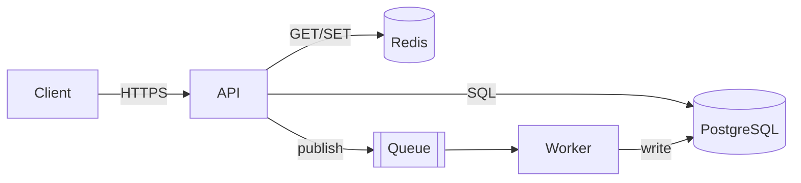

# Professional Project Builder

## Why this skill exists

Recruiters and interviewers judge a project in a few minutes by looking at its README, its structure, its diagrams, its tests, and whether the author can explain trade-offs. A tutorial-style project with everything in one folder reads as junior work. A smaller project with a clear design, a measured result, a failure test, and honest documentation reads as senior. This skill makes every project follow that second pattern. Follow the phases in order. The deliverables at each phase are what make the project defensible in an interview, so do not skip them to save time.

## Operating principles

1. **Depth over breadth.** One hard problem solved properly beats five features done shallowly. Cut scope before cutting quality.
2. **Design before code, but only as much design as needed.** A one-page design doc and two diagrams are enough for a 2-3 week project.
3. **Every important decision has a reason.** If a choice cannot be justified with a trade-off, make it a recorded decision (ADR) only once you can defend it.
4. **Measure, do not claim.** Any performance, reliability, or accuracy statement must come from a benchmark or test that is committed to the repo and reproducible.
5. **Prove the failure path.** Include at least one test that kills, delays, corrupts, or overloads something and shows the system behaves correctly.
6. **Boring, standard tooling.** Use widely understood tools. Cleverness belongs in the core algorithm, not in the build system.
7. **Never fabricate.** Do not invent benchmark numbers, test counts, or architecture that does not exist in the code. Use `[X]` placeholders until measured.

## Phase 0: Scope and requirements

Produce a short spec before any design:

- **Problem statement** (2-3 sentences): the technical problem class being studied. It must not be a clone of an existing product. Study a component or a problem (for example idempotent payments ledger, oversell-proof inventory, rate limiter), not a brand.
- **Functional requirements** (5-8 bullets, MoSCoW: must/should/could).
- **Non-functional requirements** with numbers: target throughput, p99 latency, durability, consistency model, availability. Estimate with back-of-envelope math and show it (requests per second, data size per record, storage per day, memory for the cache).
- **Non-goals:** explicitly list what you will not build. This is what keeps the project finishable.
- **Success metric:** the one measurable result that will go on the resume (for example "p99 under 5 ms at 10k ops/s" or "zero oversells under 500 concurrent buyers").
- **Time box:** week-by-week plan with a working vertical slice by the end of week one.

Ask the user for missing constraints (time, language preferences, target company or role). If the project exists to fit a specific company, the technology the company values should drive the stack choice.

## Phase 1: High-level design (HLD)

Decide, in this order, and write one line of justification for each:

1. **Architecture style:** modular monolith by default. Choose microservices only if the project is specifically about distributed systems; otherwise it adds cost with no learning value.
2. **Components and boundaries:** each with a single responsibility and a clear owner of data.
3. **Data model and storage:** relational by default, with a stated reason for any NoSQL, cache, or log-structured choice. State the source of truth and which stores are derived or rebuildable.
4. **Communication:** synchronous (REST/gRPC) versus asynchronous (queue, outbox, events). Say why.
5. **Consistency and concurrency:** what must be strongly consistent, what can be eventual, and how conflicts are resolved (locks, optimistic versioning, CAS, CRDTs, serializable transactions).
6. **Failure model:** what fails (process crash, network partition, slow dependency, duplicate delivery, disk full) and what the system guarantees in each case.
7. **Scaling story:** what breaks first at 10x load and what you would change. Documented, not necessarily built.

### System design concept checklist (use the ones that apply, name them in the design doc)

- Idempotency keys and exactly-once effects via at-least-once delivery plus dedup
- Outbox pattern for reliable events; retries with exponential backoff and jitter; dead-letter queues
- Caching: cache-aside, write-through, TTL and invalidation strategy, stampede protection
- Rate limiting: token bucket, sliding window; backpressure and load shedding
- Concurrency control: optimistic versus pessimistic locking, atomic Redis Lua scripts, transactions and isolation levels
- Data partitioning and indexing; query plans (check `EXPLAIN`); connection pooling
- Replication and consensus basics where relevant (Raft, leader election, quorum)
- Durability: write-ahead log, fsync policy, crash recovery
- Observability: structured logs, metrics (RED/USE), tracing, health checks

## Phase 2: Low-level design (LLD)

- **Domain modeling first.** Identify entities, value objects, aggregates, and invariants. Put business rules in the domain layer, not in controllers or SQL strings.
- **Layering:** transport (HTTP/CLI) → application/service → domain → infrastructure (DB, cache, queue). Dependencies point inward. The domain layer imports nothing from infrastructure.
- **Interfaces at boundaries:** define repository, clock, ID generator, and external-client interfaces so tests can swap fakes in. Use dependency injection through constructors; avoid global singletons.
- **SOLID in practice:** single responsibility per module; open for extension through strategy objects instead of long `if` chains; small interfaces; depend on abstractions.
- **Patterns, only when they remove real complexity:**
  - Strategy (compaction policy, eviction policy, rate-limit algorithm)
  - Factory/Builder (complex construction, configuration)
  - Repository (persistence boundary)
  - Observer/Event (decoupled notifications)
  - State machine (order, payment, connection lifecycle). Encode legal transitions explicitly.
  - Command/Outbox (reliable side effects)
  - Decorator/Middleware (auth, logging, retries)
  Name the pattern in a code comment only where it clarifies intent. Never add a pattern for show.
- **Error model:** typed domain errors, mapped to transport errors in one place. Never swallow exceptions. Distinguish retryable from permanent failures.
- **Concurrency design:** state which objects are shared, what protects them, and the lock ordering. For C++, state ownership and lifetimes (RAII, smart pointers, no raw ownership) and the memory-ordering assumptions of any lock-free structure.
- **Complexity notes:** record the time and space complexity of core operations in the design doc.

Deliverable: class/module diagram of the core domain plus a list of the public interfaces with their contracts.

## Phase 3: Repository and directory structure

Pick the layout matching the language. Common rules: one clear entry point, tests mirror source, config separate from code, no secrets in git, a top-level `README.md`, `LICENSE`, `.gitignore`, `Makefile` or task runner, and `docs/`.

### TypeScript / Node backend (layered, modular)

```
project/
├── README.md
├── Makefile
├── docker-compose.yml
├── Dockerfile
├── .env.example
├── package.json  tsconfig.json  eslint config
├── docs/
│   ├── design.md
│   ├── architecture.md
│   ├── benchmarks.md
│   ├── adr/0001-<decision>.md
│   └── diagrams/            # Mermaid sources
├── src/
│   ├── main.ts              # composition root, wires dependencies
│   ├── config/
│   ├── api/                 # routes, controllers, validation, middleware
│   ├── application/         # use cases / services
│   ├── domain/              # entities, value objects, rules, errors
│   ├── infrastructure/      # db, cache, queue, external clients
│   └── observability/       # logger, metrics, tracing
├── migrations/
├── scripts/                 # seed, load test, chaos test
└── tests/
    ├── unit/  integration/  e2e/  property/  load/
```

### C++ systems project (CMake)

```
project/
├── CMakeLists.txt  CMakePresets.json
├── README.md  docs/ (design.md, adr/, diagrams/, benchmarks.md)
├── include/<project>/       # public headers only
├── src/                     # implementation, grouped by component
├── tests/                   # unit (GoogleTest/Catch2), fuzz, crash-recovery
├── bench/                   # Google Benchmark, results committed as CSV/MD
├── tools/                   # CLIs, trace replayers
├── cmake/  .clang-format  .clang-tidy
└── .github/workflows/ci.yml # build matrix, ASan/UBSan/TSan, tests
```

### Python service

```
project/
├── pyproject.toml  Makefile  Dockerfile  README.md
├── src/<package>/ (api/, services/, domain/, infra/, config.py)
├── tests/ (unit/, integration/, property/)
├── docs/  scripts/  migrations/
```

Rules: keep files under roughly 300 lines; name by responsibility not by type dumping (`ledger/` not `utils/`); no `utils`, `helpers`, or `misc` catch-alls; commit a generated-files ignore list; pin dependencies with a lockfile.

## Phase 4: Diagrams

Use **Mermaid** (renders in GitHub and most doc tools) and commit the source in `docs/diagrams/` and embed in the README. Create these, and only as many as add clarity:

1. **System context / component diagram (C4 levels 1-2):** users, the system, and external systems; then the containers (API, workers, DB, cache, queue) with the protocol on each arrow.
2. **Sequence diagram for the core flow and the main failure flow:** actor lifelines, the request, each internal hop, retries and timeouts shown explicitly.
3. **ER diagram** for the data model, with keys, constraints, and indexes noted.
4. **State diagram** for any entity with a lifecycle (order, payment, connection, SSTable).
5. **Class/module diagram** for the core domain (from Phase 2).
6. **Deployment diagram** (optional): how Docker Compose or Kubernetes lays it out.

Diagram quality rules:
- One diagram answers one question. Title it with that question.
- Label every arrow with what flows over it (protocol, event name, or operation).
- Keep to about 8-12 nodes; split rather than shrink.
- Show data stores and the source of truth distinctly from caches and derived data.
- Color or style sparingly; clarity beats decoration. Always include a short caption below the diagram saying what to notice.

Mermaid skeletons:



```mermaid
sequenceDiagram
  participant C as Client
  participant A as API
  participant D as DB
  C->>A: POST /orders (Idempotency-Key)
  A->>D: BEGIN; check key
  alt key seen
    D-->>A: stored response
    A-->>C: 200 (replayed)
  else new
    A->>D: insert order + outbox
    D-->>A: COMMIT
    A-->>C: 201
  end
```

When the user wants a rendered image, create the diagram using the available visual tools (an inline diagram or a published artifact). Keep the Mermaid source in the repo regardless.

## Phase 5: Implementation standards

- **Vertical slice first:** get one request flowing through every layer end to end in week one, then widen.
- **API design (if applicable):** resource-oriented REST or a clear RPC set; versioned paths (`/v1`); consistent error body with a stable code; pagination on list endpoints; idempotency keys on unsafe retries; input validated at the edge; OpenAPI spec committed.
- **Database:** migrations for every schema change, never manual edits; constraints and foreign keys enforce invariants; indexes justified by actual queries; transactions scoped small; no N+1 queries.
- **Configuration:** twelve-factor: environment variables, validated at startup, fail fast with a clear message; `.env.example` committed, real secrets never.
- **Logging:** structured (JSON), request/correlation IDs, no sensitive data, log levels used consistently.
- **Time and randomness:** inject a clock and ID generator so tests are deterministic.
- **Resource safety:** timeouts on every outbound call; bounded queues and pools; graceful shutdown that drains in-flight work.
- **Code quality:** formatter and linter enforced in CI; meaningful names; small functions; comments explain why, not what; no dead code or commented-out blocks.
- **Git hygiene:** small commits with clear messages (`feat:`, `fix:`, `test:`, `docs:`), a feature branch per milestone, tags for milestones. The history should tell the story of the build.

## Phase 6: Testing strategy

Aim for confidence, not a coverage number. Cover:

- **Unit tests:** domain rules and pure logic, fast and deterministic.
- **Integration tests:** real database/cache in Docker (Testcontainers or Compose), covering repositories, transactions, and migrations.
- **End-to-end tests:** a few that exercise the main user journeys over the real transport.
- **Property-based or fuzz tests:** for invariants (ledger always balances, sorted order preserved, merge is commutative and idempotent). Strongly recommended for core logic.
- **Failure / chaos tests:** kill the process mid-write and recover; drop or delay network calls; deliver duplicates and out-of-order messages; fill a queue. Assert the stated guarantees hold.
- **Concurrency tests:** many parallel clients on the same contended resource; for C++, run under ThreadSanitizer and AddressSanitizer.
- **Load and benchmark tests:** reproducible script (k6, wrk, Locust, Google Benchmark), warm-up phase, fixed hardware notes, report p50/p95/p99 and throughput, commit raw results.
- **Evaluation sets (for AI/search projects):** a labeled set with the metric defined up front (recall@k, MRR, accuracy), reporting before/after for each change.

Every test in the repo should run with one command (`make test`). CI runs them on every push.

## Phase 7: CI/CD, packaging, observability

- **CI (GitHub Actions):** lint, build, unit and integration tests, sanitizers (C/C++), dependency audit, container build. Fail on warnings.
- **Docker:** multi-stage Dockerfile, non-root user, pinned base image, small final image, `HEALTHCHECK`. `docker compose up` brings up the whole system with seed data.
- **Observability:** `/health` and `/ready` endpoints; metrics endpoint (Prometheus format) with request rate, errors, latency histograms; optional tracing. A small Grafana dashboard JSON committed is a strong signal.
- **Release:** semantic version tags and a short changelog.

## Phase 8: Security baseline

Validate and sanitize all input; parameterized queries only; hash passwords with a modern algorithm (argon2/bcrypt) if auth exists; short-lived tokens; role-based access control enforced in one middleware; rate limit public endpoints; secrets via env or a secrets manager; least-privilege DB user; dependency scanning in CI; document the threat model in a few lines (what you protect, from whom).

## Phase 9: Documentation (the part interviewers read first)

**README.md structure (use this order):**
1. One-line pitch and the problem it studies (not a product clone)
2. Key results in a small table (measured numbers with the date and hardware)
3. Architecture diagram and a 3-sentence explanation
4. Quickstart: three commands to run it, three to test it
5. Features and non-goals
6. Design decisions and trade-offs (links to ADRs)
7. Testing and failure scenarios covered
8. Benchmarks: method, results, how to reproduce
9. Limitations and "what I would do next"
10. Repo layout

**docs/design.md:** requirements, back-of-envelope numbers, HLD, LLD, data model, failure model, consistency choices, scaling story, open questions.

**ADRs (`docs/adr/NNNN-title.md`):** Context, Decision, Alternatives considered, Consequences. Write 3-6, covering the real forks (database choice, locking strategy, sync versus async, caching approach).

## Phase 10: Definition of done and resume translation

Do not call the project finished until every item is true:

- [ ] Runs from a clean clone with the quickstart commands
- [ ] README results table filled with measured numbers; benchmark scripts committed
- [ ] At least two diagrams (component and sequence) embedded in the README
- [ ] Unit, integration, and one failure/chaos test passing in CI
- [ ] Linter, formatter, and sanitizers (where applicable) clean
- [ ] Design doc and at least three ADRs written
- [ ] No secrets, TODO dumps, or dead code in the repo
- [ ] A 60-second explanation can be given: problem, key decision, measured result, one thing that went wrong and how it was fixed

**Resume bullets (2-3 per project, past tense, quantified):**
- Bullet 1: what was built and the core technique
- Bullet 2: the hard decision or guarantee (consistency, durability, correctness) with how it was validated
- Bullet 3: the measured result (latency, throughput, convergence, accuracy)

Use real numbers only. Prepare answers for "why this design, what are the trade-offs, what breaks at 10x, how did you test failure".

## How to respond when this skill is invoked

- **Starting a project:** run Phase 0 questions, then deliver the spec, HLD summary, a Mermaid component diagram and sequence diagram, the directory tree, a week-by-week plan, and the definition-of-done checklist. Offer to scaffold the repo.
- **Scaffolding:** create the directory tree, config files, `Makefile`, Dockerfile, CI workflow, and stub files with clear module boundaries. Make sure it builds and the first test passes before saying it is done.
- **Reviewing an existing project:** read the repo, then report findings grouped by design, structure, testing, docs, and operations, ordered by impact, with concrete fixes. Do not rewrite everything.
- **Only diagrams:** ask what question each diagram should answer, then produce Mermaid (and a rendered version if asked).
- **Stack uncertain:** recommend one default with a one-line reason and mention one alternative; do not present a menu of five.

If the user's request conflicts with these standards (for example "skip tests", or "clone this app"), explain briefly what the trade-off is and follow their decision once it is clear.

## Anti-patterns

- A tutorial-clone project with CRUD only and no hard problem
- Microservices with no reason, or Kubernetes for a single service
- Business logic in controllers or SQL scattered across files
- A `utils` folder that grows without bound
- Diagrams that are screenshots of boxes with no labeled arrows, or that do not match the code
- Benchmarks without method, hardware, or reproducible scripts
- Unrealistic claims ("handles millions of users") with no test behind them
- Frameworks, patterns, or technologies added only to lengthen the resume
- README that lists technologies but never explains a decision
